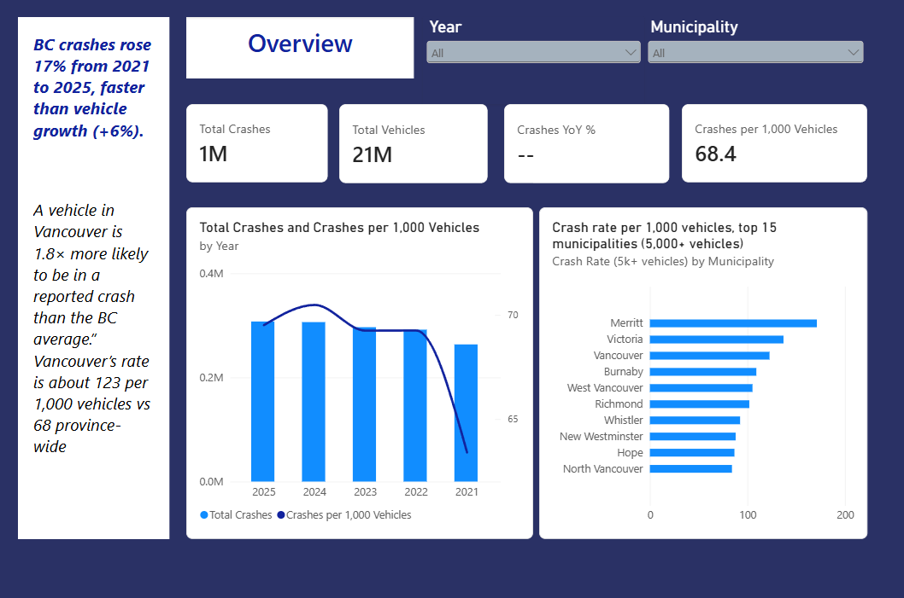
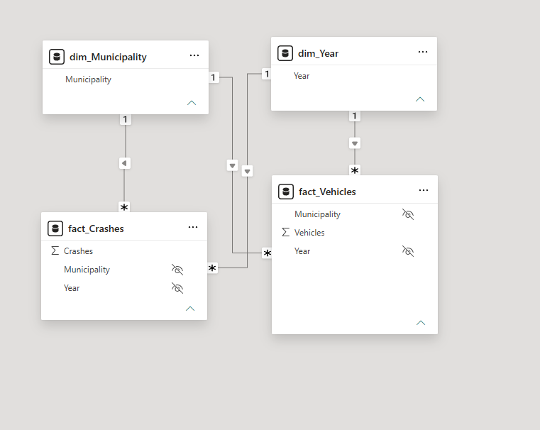

# BC Road Safety & Claims Risk Analytics (Power BI)

Power BI report on ICBC's public crash and vehicle data (2021–2025): how crashes are trending in British Columbia, and which municipalities have the highest crash rate per vehicle.

## Key findings

- **Crashes grew faster than vehicles.** Reported crashes rose 16.7% from 2021 to 2025 (263,442 → 307,440), while registered vehicles grew 6.4% (4,155,521 → 4,422,963).
- **The crash rate rose** from 63.4 to 69.5 crashes per 1,000 vehicles between 2021 and 2025.
- **842 crashes a day.** BC had 307,440 ICBC-reported crashes in 2025, about one every 1.7 minutes.
- **Surrey has more registered vehicles than Vancouver in every year from 2021 to 2025, but 27% fewer crashes** over the period (170,971 vs 233,440).
- **Vancouver's crash rate is about 1.8× the BC average** for 2021–2025 (≈123 vs 68.4 per 1,000 vehicles).

## Business questions

1. How have crash counts trended year over year?
2. Which municipalities have the highest crash rate per 1,000 registered vehicles, not just the most crashes?

## Data sources

| File | Source | Notes |
| --- | --- | --- |
| `data/raw/icbc_crashes.csv` | ICBC Statistics: Reported crashes | Crashes by municipality × year |
| `data/raw/icbc_vehicle_population.csv` | ICBC Statistics: Vehicle policies in force | Vehicles by municipality × year |

Data © ICBC, used under the ICBC Open Data Licence. Downloaded October 2026.

**Caveats**
- Crash data comes from reports made to ICBC and is self-reported, so it may not be precisely verifiable.
- ICBC crash counts are much larger than police-reported counts, because police do not attend every crash.

## Power Query: how the data was cleaned

Both files are Tableau crosstab exports: UTF-16 encoded, tab-delimited, wide (one column per year), with thousands separators and a Grand Total.

| Step | Why |
| --- | --- |
| Import with encoding 1200 (UTF-16) and tab delimiter | Tableau export format |
| Remove the Grand Total column and row (filtered by value, not position) | Avoid double counting; robust to row order changes |
| **Unpivot** year columns → `Municipality, Year, Crashes` | Wide → long, so years can be filtered and related |
| Type numbers using the `en-US` / `en-CA` locale | Parses `40,216` correctly |
| Trim and Proper-case municipality names | `VANCOUVER` vs `Vancouver` across files |
| Append both tables → distinct names → `dim_Municipality` (888 places) | Shared dimension covering every place in either file |
| Same pattern → `dim_Year` | Shared year dimension |

### Data quality checks

Two **left anti joins** (kept in the project as `chk_` queries, not loaded):

- **322 places appear in crash data but not vehicle data**, accounting for 10,294 crashes (**0.7%** of all crashes). The list contains small communities, not spelling variants of larger municipalities. They're kept in crash totals and have no rate.
- **33 places have vehicles but no crashes.** The largest averages about 3,100 vehicles per year, so no major municipality is affected. Their rate is 0.
- **Small-denominator rule:** municipality rankings only include places averaging 5,000+ vehicles per year, so tiny places with extreme rates don't dominate.

## Data model

Star schema: two fact tables sharing two conformed dimensions, with one-to-many, single-direction relationships. The facts are never joined to each other directly.

## Measures (DAX)

| Measure | Logic |
| --- | --- |
| Total Crashes | `SUM(fact_Crashes[Crashes])` |
| Total Vehicles | `SUM(fact_Vehicles[Vehicles])` |
| Crashes per 1,000 Vehicles | `DIVIDE([Total Crashes], [Total Vehicles]) * 1000`, calculated after filtering, never averaged |
| Crashes YoY % | `CALCULATE` shifts the year filter to the prior year; returns blank unless exactly one year is selected |
| Crash Rate (5k+ vehicles) | Rate shown only where average annual vehicles ≥ 5,000; used for Top-N ranking |

## How to run

1. Clone the repo and open `report/BCRoadSafety.pbip` in Power BI Desktop (Windows).
2. The queries currently point to `D:\road_safety_powerbi\data\raw\`. Update the path in Power Query (Home → Transform data → Source step) to your clone location, then refresh.

The project is saved in **PBIP format** (TMDL for the model, PBIR for the report), so every query, measure and visual change is diffable in Git.
